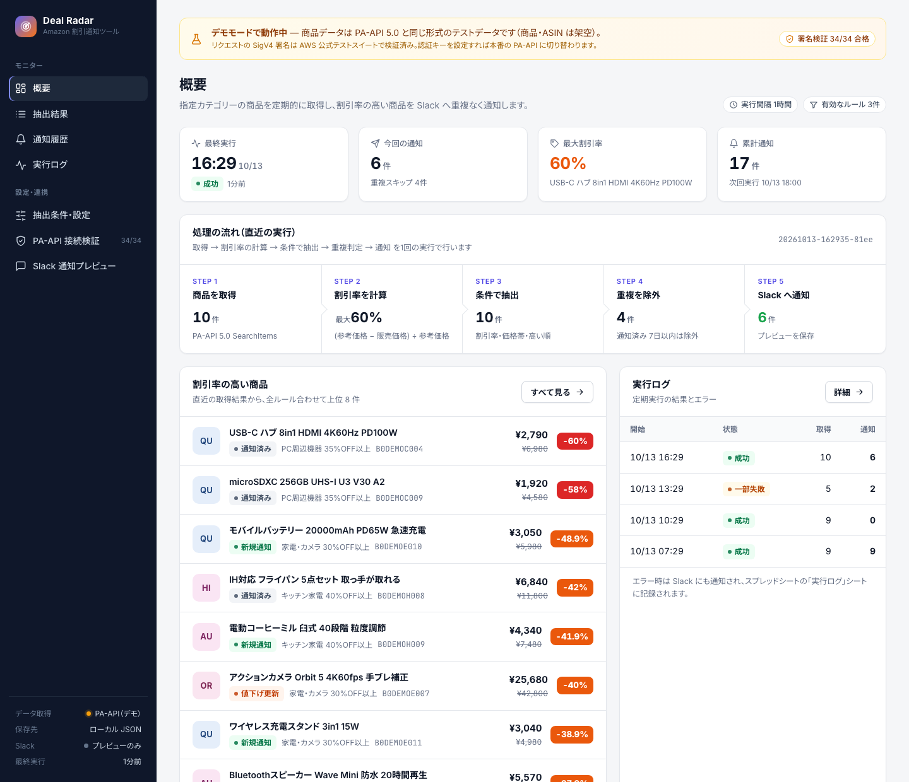
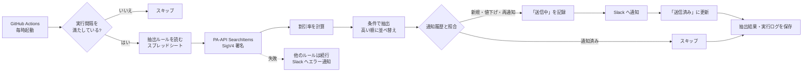
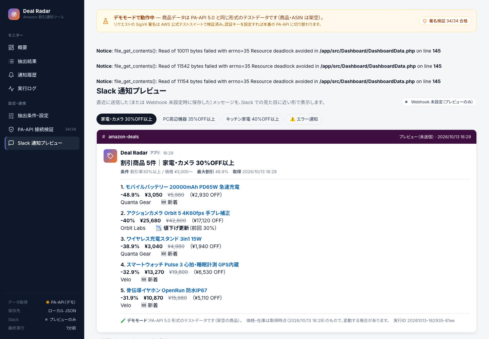
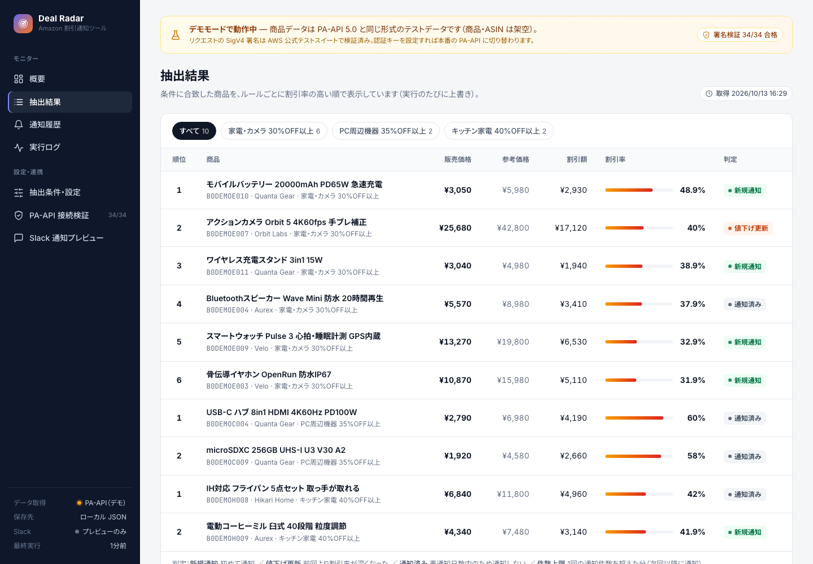
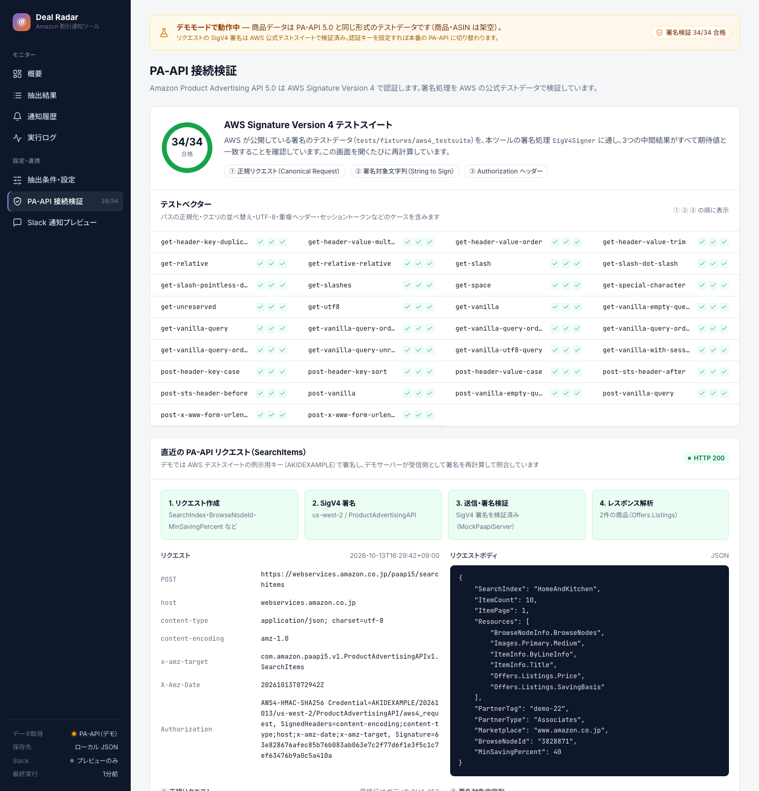
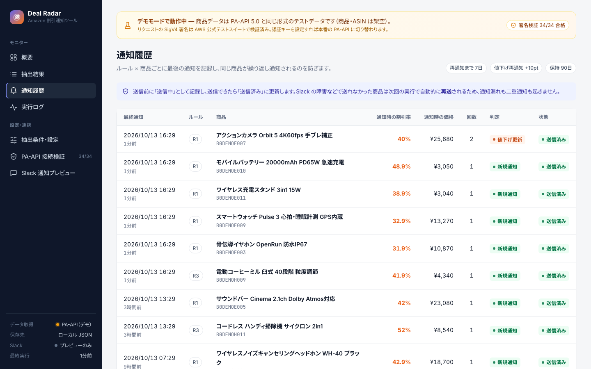

# Deal Radar — Amazon 割引商品の収集・分析・Slack 通知ツール

Amazon の指定カテゴリーから商品情報を定期的に取得し、**割引率を計算して条件に合う商品だけを Slack へ重複なく通知する**ツールです。
設定・抽出結果・通知履歴・実行ログは **Google スプレッドシート** に保存し、スプレッドシートがそのまま設定画面になります。

- **取得**：Amazon 公式の Product Advertising API（PA-API 5.0）。スクレイピングは行いません
- **言語**：PHP 8.4（Docker で動作）／ Google Sheets API（GAS は使いません）
- **定期実行**：GitHub Actions（サーバー不要・無料枠内）。レンタルサーバーの cron でも動きます



> [!NOTE]
> **このリポジトリはデモモードで動きます。** PA-API の利用にはアソシエイトの売上実績が必要なため、商品データは PA-API 5.0 と同じ JSON 形式のテストデータ（架空の商品）です。
> 一方、PA-API の認証に使う **AWS Signature Version 4 の署名処理は、AWS が公開している公式テストスイート（34件）で検証済み**です。デモでも本物と同じ署名付きリクエストを作り、受信側のデモサーバーが署名を再計算して照合しています。
> 認証キーを設定すれば、コードを変えずに本番の PA-API へ切り替わります。

---

## 要件と実装の対応

| 要件 | 実装 |
|---|---|
| 指定カテゴリーから商品情報を取得 | PA-API 5.0 `SearchItems` を SearchIndex＋BrowseNodeId（カテゴリーID）で呼び出し、ページ送りで取得 |
| 商品名・URL・価格・参考価格・割引率を収集 | `ItemInfo.Title` / `DetailPageURL` / `Offers.Listings.Price` / `Offers.Listings.SavingBasis` を取得 |
| 利用規約・API 利用条件に沿った取得 | 公式 API のみ使用。1秒1リクエストの制限を守り、`TooManyRequests` は指数バックオフで再試行 |
| 定期的に更新 | GitHub Actions で毎時起動。実際の実行間隔はスプレッドシートで設定 |
| 割引率の計算 | `(参考価格 − 販売価格) ÷ 参考価格`。小数第1位で切り捨て。参考価格がなければ割引額から逆算 |
| 条件で抽出・並べ替え | ルールごとに最低割引率・価格帯で絞り込み、**割引率の高い順**（同率なら割引額の大きい順） |
| 一覧で確認 | スプレッドシート「抽出結果」シート／ダッシュボード |
| Slack 通知（商品名・価格・割引率・URL） | Incoming Webhook ＋ Block Kit |
| 同じ商品の重複通知を防ぐ | 「通知履歴」と照合（下記の判定表） |
| カテゴリー・抽出条件の変更 | スプレッドシート「抽出ルール」シート（プルダウン・入力チェック付き） |
| 定期実行の設定 | 「基本設定」シートの実行間隔 |
| エラー時のログ確認 | 「実行ログ」シート、Slack へのエラー通知、`storage/logs/*.log` |
| 簡易的な管理画面 | **設定はスプレッドシートで完結するため不要**と判断。代わりに閲覧専用のダッシュボードを用意 |

## 処理の流れ



## 重複防止のルール

通知履歴は **ルール × 商品（ASIN）** ごとに1行で管理します。

| 状況 | 判定 | 通知 |
|---|---|---|
| 通知したことがない | 新規通知 | する |
| 前回の送信が失敗、または「送信中」のまま | 再送 | する |
| 再通知日数（既定7日）以内で、割引率が前回より **+10pt 以上** 深い | 値下げ更新 | する |
| 再通知日数以内 | 通知済み | しない |
| 再通知日数を経過 | 再通知 | する |
| 1回の通知件数（ルールごとの上限）を超えた | 件数上限 | しない（次回以降に通知） |

送信前に「送信中」として記録し、成功したら「送信済み」に更新します。Slack の障害や処理の中断があっても次回の実行で再送されるため、**通知漏れと二重通知の両方を防げます**。GitHub Actions では `concurrency` で同時実行も防いでいます。

## スクリーンショット

| Slack 通知 | 抽出結果 |
|---|---|
|  |  |

| PA-API 接続検証（AWS 公式テストスイート） | 通知履歴 |
|---|---|
|  |  |

## すぐに試す（Docker）

必要なのは Docker だけです。PHP をローカルに入れる必要はありません。

```bash
cp .env.example .env
docker compose run --rm app composer install
docker compose run --rm app php bin/verify-sigv4.php   # 署名処理を AWS 公式テストスイートで検証
docker compose run --rm app php bin/seed-demo.php      # デモ用に4回分の実行履歴を作る
docker compose up -d web                               # ダッシュボード → http://localhost:8094
```

| コマンド | 内容 |
|---|---|
| `php bin/run.php` | 実行間隔に従って実行（定期実行の入口） |
| `php bin/run.php --force` | 実行間隔を無視して今すぐ実行 |
| `php bin/run.php --dry-run` | 取得・抽出のみ。保存も通知もしない |
| `php bin/run.php --rule=R1` | 指定したルールだけ実行 |
| `php bin/setup-sheet.php` | スプレッドシートのタブ・見出し・書式・入力規則を整える |
| `php bin/verify-sigv4.php` | AWS 公式テストスイートで署名処理を検証 |
| `php bin/seed-demo.php` / `bin/reset-demo.php` | デモデータの作成／消去 |
| `vendor/bin/phpunit` | テスト（66件） |

いずれも `docker compose run --rm app` を前に付けて実行します。

### デモサーバーでエラーを再現する

```bash
docker compose run --rm -e MOCK_SIMULATE_ERROR=throttle  app php bin/run.php --force  # 初回だけ TooManyRequests → 再試行して成功
docker compose run --rm -e MOCK_SIMULATE_ERROR=Computers app php bin/run.php --force  # 1カテゴリーだけ失敗 → 一部失敗として記録・通知
```

## 本番環境の設定

### 1. Google スプレッドシート

1. Google Cloud でプロジェクトを作り、**Google Sheets API** を有効にする
2. サービスアカウントを作り、鍵（JSON）を `credentials/service-account.json` に置く（Git 管理外）
3. スプレッドシートを新規作成し、サービスアカウントのメールアドレスを **編集者** として共有する
4. `.env` に `STORAGE=sheets` と `SPREADSHEET_ID` を設定し、`php bin/setup-sheet.php` を実行する

| シート | 内容 |
|---|---|
| 抽出ルール | 有効（チェックボックス）・カテゴリー（プルダウン）・最低割引率・価格帯・最大通知件数 |
| 基本設定 | 実行間隔・再通知までの日数・値下げ再通知のしきい値・取得ページ数・履歴の保持日数 |
| 抽出結果 | 直近の抽出結果（毎回上書き。割引率はグラデーション表示） |
| 通知履歴 | ルール × 商品ごとの最終通知（重複判定に使用） |
| 実行ログ | 実行ごとの件数・所要時間・状態・エラー内容 |

### 2. Slack

Slack アプリの Incoming Webhook を作成し、`SLACK_WEBHOOK_URL` に設定します。エラー通知を別チャンネルに分けたい場合は `SLACK_ERROR_WEBHOOK_URL` も設定します。未設定の間は送信せず、ダッシュボードでプレビューだけ確認できます。

### 3. PA-API 5.0

```dotenv
DATA_SOURCE=paapi
PAAPI_ACCESS_KEY=...
PAAPI_SECRET_KEY=...
PAAPI_PARTNER_TAG=xxxxx-22
```

> [!IMPORTANT]
> PA-API の利用には **Amazon アソシエイトの承認と売上実績** が必要です（Amazon Business のアカウントとは別）。また Amazon は後継の Creators API への移行を進めています。仕様が変わった場合も、修正は `PaapiClient` と `PaapiResponseParser` だけで済む構成にしています。

### 4. GitHub Actions

リポジトリの Settings → Secrets に `SPREADSHEET_ID` / `GOOGLE_SERVICE_ACCOUNT_JSON`（鍵 JSON の中身）/ `SLACK_WEBHOOK_URL` / `PAAPI_*` を登録し、Variables に `DATA_SOURCE=paapi` を設定します。`.github/workflows/run.yml` が毎時起動し、Actions 画面の「Run workflow」から手動実行もできます。

## 運用費

| 項目 | 月額 |
|---|---|
| GitHub Actions（1時間ごと・1回1〜2分） | 0円（非公開リポジトリの無料枠 2,000分/月 以内） |
| Google スプレッドシート／Sheets API | 0円 |
| Slack Incoming Webhook | 0円 |
| PA-API 5.0 | 0円（アソシエイトの売上実績が条件） |

## 構成

```
bin/                    CLI（run / setup-sheet / verify-sigv4 / seed-demo / reset-demo）
src/
  Paapi/                SigV4Signer（署名）, PaapiClient, PaapiResponseParser, MockPaapiServer（デモ用）
  Analysis/             DiscountCalculator（割引率）, DealFilter（抽出・並べ替え）, Deduplicator（重複判定）
  Notify/               SlackMessageBuilder（Block Kit）, SlackNotifier（Webhook 送信・再試行）
  Storage/              GoogleSheetsStorage, LocalJsonStorage, SheetSetup（書式・入力規則）
  Job/                  JobRunner（1回分の処理と記録）
  Dashboard/            閲覧専用ダッシュボード
templates/, public/     ダッシュボードの画面
tests/Unit/             PHPUnit（SigV4 公式テストベクター・割引率・抽出・重複判定・一連の処理）
tests/fixtures/aws4_testsuite/   AWS Signature Version 4 Test Suite（Apache License 2.0）
fixtures/paapi/catalog.json      デモ用の架空商品カタログ
```

## 設計上の判断

- **データベースを使わない**：データ量が少なく（数カテゴリー × 数百件）、PA-API の規約上も価格の長期保存は避けるべきため、スプレッドシートで十分と判断しました。保存処理は `Storage` インターフェースで抽象化しているので、将来 MySQL などに替える場合も他の処理は変わりません。
- **管理画面を作らない**：スプレッドシートにプルダウン・チェックボックス・入力チェックを設定し、設定画面として使います。ログインや権限管理も Google の共有設定で済みます。
- **SDK に頼らず署名を実装**：依存を増やさず、API の仕様変更にも自分で追従できるよう SigV4 を自前で実装し、AWS 公式テストスイートで正しさを担保しました。
- **価格の取得時刻を明記**：Slack 通知に「価格は取得時点のもの」と時刻を表示しています（PA-API の表示要件への配慮）。
